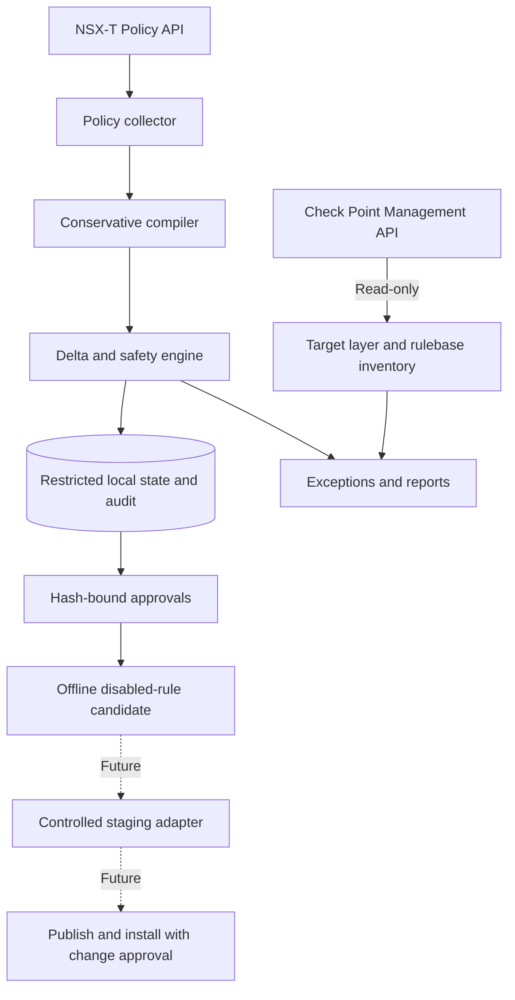
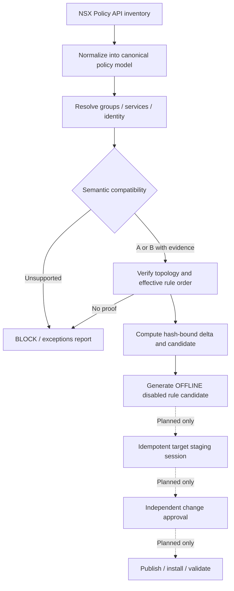

# NXTCheckpoint — NSX-T to Check Point Policy Assessment

> **Experimental read-only MVP.** Collects NSX-T Distributed Firewall policies, normalizes a conservative subset, detects changes and generates **offline disabled-rule candidates** for traditional Check Point Security Gateways. It **does not** create, update, publish or install Check Point rules.

## Project goals and boundaries

NXTCheckpoint is a generic, environment-independent toolkit for organizations planning coexistence or migration from VMware NSX-T Distributed Firewall (DFW) to centrally managed Check Point Security Gateways. It aims to make configuration assessment traceable, repeatable and safe.

**Important security distinction:** NSX DFW enforces rules near workloads. A conventional Security Gateway only enforces rules on traffic traversing it. Copying rules does not guarantee enforcement equivalence, particularly for East-West flows in the same subnet, VXLAN or distributed network. Routing, NAT, packet paths, shadow rules and implicit rules must be assessed separately.

The intended lifecycle is **observe → compare → review → stage → enforce**. The current release supports only **observe, compare, review and offline candidate generation**.

## v1.2: private offline NSX Infra export analysis

The v1.2 offline import path accepts hierarchical NSX Infra exports (UTF-8/UTF-16 BOM), reconstructs policies/rules/groups/services from `Child*` wrappers, evaluates simple static IPv4 groups and TCP/UDP services, and produces **pseudonymized** compatibility reports. All unsupported semantics are blocked conservatively; the tool does **not** perform Check Point API writes.

```bash
python -m sync_engine.offline \\
  --input /secure/private/nsx-infra-export.json \\
  --output /secure/private/assessment
```

The output contains `summary.json` (counts and reason-code distributions) and `rules.csv` (SHA-256-derived reference fingerprints, compatibility classes and reasons). The report contains no original names or IP addresses, but its hashes remain pseudonymous and may be linkable to known paths. **Keep both input and output outside the public repository.**

The importer was tested locally against a complex private NSX export **without uploading that export or its content to GitHub**. Public regression tests use synthetic names, reserved documentation address ranges and fake identifiers only. Rejection of a source rule can result from DFW scope, dual-stack protocol selection, security profile references, dynamic groups or uncertain stateful inspection semantics; this is a safety feature, not proof that migration is impossible.

**Important integration boundary:** v1.2's offline export analyser is separate from the existing online API collector. It does not automatically create the online collector's `latest_plan.json` state or drive `candidate.py`. Read the [v1.2 offline import guide](docs/OFFLINE_EXPORT_V1_2.md) for precise capabilities and limitations.

### Incremental group expression resolver

The post-v1.2 group compiler (`sync_engine/group_logic.py`) now supports conservative IPv4 group evaluation, including static CIDR unions, `AND` intersections, recursive `PathExpression` references, and `ExternalIDExpression` **only when a verified private workload-to-IP map is supplied**. Unsupported conditions, unverified identity membership, invalid addresses, cyclic groups, mixed boolean precedence and empty intersections **fail closed**.

Example with **synthetic documentation-only addresses**:

```json
{
  "example-workload-id": ["192.0.2.21", "192.0.2.22"]
}
```

```bash
python -m sync_engine.offline \\
  --input /secure/private/nsx-infra-export.json \\
  --identity-map /secure/private/workload-identity-map.json \\
  --output /secure/private/assessment
```

The mapping file is local and private. Group identities and resolved IPs are not written to the generated CSV/JSON assessment reports. **A caller-provided mapping is not an independently validated workload inventory**; production equivalence still requires identity freshness, full group membership verification, topology and Check Point rulebase checks. Current logic does not generate an enforceable target policy and has not been integration-tested against live appliance APIs.

See the [offline import and group resolver guide](docs/OFFLINE_EXPORT_V1_2.md).

### Read-only NSX workload inventory (incremental development)

The `sync_engine/inventory.py` collector now queries NSX VM IDs, fabric VIF addresses and realized IP membership of configured groups. It writes an **access-restricted private inventory** and supports age-checked identity mapping in the offline importer. The inventory file contains real VM/IP information; it is **never** intended for the public repository.

```bash
python -m sync_engine.inventory \\
  --config /etc/nsxcp/config.yaml \\
  --output /secure/private/nsx-inventory-001

python -m sync_engine.offline \\
  --input /secure/private/nsx-infra-export.json \\
  --inventory-file /secure/private/nsx-inventory-001/inventory.private.json \\
  --max-inventory-age-seconds 600 \\
  --output /secure/private/assessment
```

The collector rejects duplicate VM/IP ownership, missing VIF provenance, orphan interface references and group membership API errors. The importer rejects stale inventories. This is a **guarded assessment**: VM Tools address reporting can be stale, and effective group membership is not yet independently reconciled to a point-in-time policy snapshot. No live Check Point policy write, publish or install is supported.

Read the [identity inventory and data-protection guide](docs/IDENTITY_INVENTORY.md).

### Effective group membership reconciliation (read-only)

The new `sync_engine/reconcile.py` compares the **computed** membership of supported NSX IPv4 groups against **realized membership** returned by the NSX Policy API, using exact IPv4 subnet/range algebra without enumerating hosts.

- `MATCH`: equal effective address sets at the collected snapshots; still requires time-consistency, rule-order and gateway routing checks.
- `MISMATCH`: missing or extra addresses were detected. Only non-sensitive reason codes and block counts are reported.
- `BLOCKED`: incomplete realized membership, unsupported expression, invalid address or unresolved workload identity.
- `NOT_PERFORMED`: no private realized inventory was supplied; **not evidence of equivalence**.

When using `--inventory-file`, the offline assessment now adds an anonymized reconciliation summary and marks referencing rules with `group_membership_not_verified` when their groups are not a match. The public project does not include private exports or reconciliation outputs.

The offline workflow remains **read-only** and **cannot generate live Check Point policy changes**. Realized membership equality does not prove NSX DFW and a central Security Gateway have identical enforcement placement.

See [Group membership reconciliation](docs/GROUP_RECONCILIATION.md).

## Capability and maturity

| Capability | Status | Behaviour |
|---|---|---|
| NSX Policy API collection | Implemented | Policies, rules, groups and services in configured domains; cursor pagination |
| Conservative policy normalization | Implemented | Explicit IPv4 groups and L4 TCP/UDP services; unsupported constructs reported |
| Rule change detection | Implemented | Added, modified, removed and unchanged, using stable source IDs and hashes |
| Safety checks | Implemented | Rejects empty collections and excessive deltas |
| Check Point Management API | Read-only | Login, access layer/rulebase inventory, logout |
| Offline candidate export | Implemented | Rule-level hash approval and topology evidence; rules disabled |
| Periodic scheduling | Implemented | systemd service/timer, initially every 5 minutes |
| Offline hierarchical Infra export importer | Implemented in v1.2 | UTF-8/UTF-16, Child* wrappers, pseudonymized reports; separate from online collector |
| Conditional expression resolver | Implemented with safeguards | IPv4, AND/OR (homogeneous), path references, optional privately mapped workload IDs |
| NSX workload identity inventory | Read-only prototype | VM/VIF collection and effective group member query; private data with freshness checks |
| Computed vs effective group reconciliation | Implemented for supported IPv4 groups | Detects exact set mismatches and blocks affected rules; not an atomic snapshot or enforcement proof |
| Check Point object/rule writes | Not implemented | No live staging |
| Publish and install policy | Not implemented | No automatic enforcement |
| Managed rollback / HA / drift remediation | Not implemented | Future work |

## Architecture



No component currently changes the Check Point configuration. The scope is **NSX DFW assessment**, not migration of virtual networking, NAT, Gateway Firewall or topology.

## Requirements

- Linux with Python 3.10+, `venv`, and optionally systemd.
- HTTPS reachability to NSX Manager and Check Point Management Server.
- NSX Policy API dedicated read-only credentials for configured domains.
- Check Point Management API key permitted to read the existing access layer and rulebase.
- Trusted CA certificate bundles for both endpoints; TLS verification must stay enabled.
- Restricted filesystem permissions for credentials, inventory and reports.
- Packet-path and topology evidence before approving candidates.

**Compatibility:** versions of NSX and Check Point APIs differ. No formal compatibility matrix has yet been certified. Test with the exact versions in your environment.

## Project structure

```text
nxtcheckpoint/
├── README.md
├── requirements.txt
├── pyproject.toml
├── config.example.yaml
├── sync_engine/
│   ├── cli.py
│   ├── nsx.py
│   ├── checkpoint.py
│   ├── http.py
│   ├── model.py
│   └── candidate.py
├── deploy/
│   ├── nsxcp.service
│   └── nsxcp.timer
├── docs/
│   ├── ARQUITECTURA.md
│   ├── MATRIZ_CONVERSAO.csv
│   ├── OFFLINE_EXPORT_V1_2.md
│   ├── IDENTITY_INVENTORY.md
│   ├── GROUP_RECONCILIATION.md
│   ├── AUTOMATIZACAO_CONVERSAO.md
│   └── GO_NO_GO.md
├── examples/approvals.example.json
└── tests/
    ├── test_model.py
    ├── test_offline.py
    ├── test_group_logic.py
    ├── test_inventory.py
    └── test_reconcile.py
```

## Quick start

```bash
git clone https://github.com/emanique/nxtcheckpoint.git
cd nxtcheckpoint
python3 -m venv .venv
source .venv/bin/activate
pip install -r requirements.txt
pytest -q
cp config.example.yaml config.local.yaml
```

Update the local configuration with the source NSX endpoint, Check Point management endpoint, domain(s), trusted CA paths, existing Check Point layer and restricted state directory. Never commit local configuration with sensitive values, credentials or topology data.

```bash
export NSX_USER='readonly-account'
export NSX_PASSWORD='your-secret'
# Only needed with --check-checkpoint
export CP_API_KEY='management-api-key'
python -m sync_engine.cli --config ./config.local.yaml
python -m sync_engine.cli --config ./config.local.yaml --check-checkpoint
```

The second command queries Check Point **read-only**. Avoid storing secrets in interactive shell history on shared systems; use a secret manager or secured service environment file.

### Example configuration

```yaml
nsx:
  url: https://nsx-manager.example.internal
  username_env: NSX_USER
  password_env: NSX_PASSWORD
  ca_bundle: /etc/nsxcp/ca-nsx.pem
  domains: [default]
checkpoint:
  url: https://checkpoint-management.example.internal
  api_key_env: CP_API_KEY
  ca_bundle: /etc/nsxcp/ca-checkpoint.pem
  layer: NSX_MIGRATED_STAGING
  management_domain: null
sync:
  interval_seconds: 300
  state_dir: /var/lib/nsxcp
  max_rules: 5000
  max_change_percent: 15
  allow_ips: []
  approved_rule_prefix: NSXMIG_
  approvals_file: /etc/nsxcp/approvals.json
```

`interval_seconds` controls CLI `--loop`, while the systemd timer has an independent five-minute setting. `allow_ips` and `approved_rule_prefix` are configuration/reserved fields in this MVP; they do not activate network filtering or policy writes.

## Linux systemd deployment

```bash
sudo mkdir -p /opt/nsx-checkpoint-sync /etc/nsxcp /var/lib/nsxcp
sudo cp -a . /opt/nsx-checkpoint-sync/
cd /opt/nsx-checkpoint-sync
sudo python3 -m venv .venv
sudo .venv/bin/pip install -r requirements.txt
sudo cp config.example.yaml /etc/nsxcp/config.yaml
id nsxcp >/dev/null 2>&1 || sudo useradd --system --home /var/lib/nsxcp --shell /usr/sbin/nologin nsxcp
sudo chown nsxcp:nsxcp /var/lib/nsxcp
sudo install -o root -g nsxcp -m 0640 /dev/null /etc/nsxcp/credentials.env
sudo cp deploy/nsxcp.service deploy/nsxcp.timer /etc/systemd/system/
```

Configure `/etc/nsxcp/config.yaml`, trusted CA bundles and the root-protected `/etc/nsxcp/credentials.env` file in systemd `KEY=value` format (without `export`):

```ini
NSX_USER=readonly-account
NSX_PASSWORD=replace-me
CP_API_KEY=replace-me
```

The shipped service uses `--check-checkpoint`: supply a valid Management API key and target layer, or remove that flag if only collecting NSX. Ensure the service account can read CA/config files and write to `/var/lib/nsxcp`.

```bash
sudo systemctl daemon-reload
sudo systemctl enable --now nsxcp.timer
sudo systemctl start nsxcp.service
systemctl list-timers nsxcp.timer
journalctl -u nsxcp.service -n 100 --no-pager
```

Use **either** the systemd timer **or** `--loop`, not both; the MVP does not have cross-process locking or distributed leader election.

## State files and confidentiality

| File | Contents |
|---|---|
| `latest_snapshot.json` | Raw NSX inventory, including potentially sensitive IPs and policies |
| `latest_plan.json` | Compiled rules, hashes and conversion exceptions |
| `latest_report.json` | Cycle UTC timestamp, deltas and validation results |
| `last_good.json` | Last successfully accepted assessment baseline |
| `history/*.json` | Historical run summaries |
| `latest_candidate.json` | Optional offline candidate with disabled rules |

**Note:** `last_good.json` is not a record of policies actually installed on Check Point. Keep the state directory outside Git, protected and subject to operational retention/backup controls.

## Delta and fail-closed processing

The collector computes SHA-256 fingerprints over canonical rule representations, compares source IDs with the previous accepted assessment, and classifies changes as added, removed, modified or unchanged. The process blocks empty inventories and excessive changed-rule percentages according to `max_change_percent`.

A successful assessment only confirms local collection/compilation conditions. It does **not** demonstrate a complete NSX configuration inventory, live rule equivalence or production readiness.

## Candidate generation

Review `latest_plan.json` and the exceptions, then provide a JSON approval map keyed by `source_id`, with the matching `hash`, `topology_evidence` and `approver`. See `examples/approvals.example.json`.

```bash
python -m sync_engine.candidate \
  --state-dir /var/lib/nsxcp \
  --approvals /etc/nsxcp/approvals.json
```

The exporter rejects unsupported/changed/unapproved rules. Every accepted rule is output with `enabled: false`; **there is no Check Point API write**. Approval fields are checked for presence and hash equality, not cryptographic identity or evidence authenticity. An external change-management process must govern real approvals.

## Rule compatibility and automated conversion

A complete, field-level compatibility matrix is maintained in [docs/MATRIZ_CONVERSAO.csv](docs/MATRIZ_CONVERSAO.csv), with target Check Point mapping, classification, current implementation status, automation strategy and safety gate. The proposed compiler, canonical schema and future API staging workflow are detailed in [docs/AUTOMATIZACAO_CONVERSAO.md](docs/AUTOMATIZACAO_CONVERSAO.md).

### Compatibility levels

| Level | Meaning | Enforcement rule |
|---|---|---|
| **A — Direct syntax mapping** | Deterministic mapping of an object, action or field | **Not** permission for automatic installation; packet-path and rulebase checks still required |
| **B — Conditional** | Translation depends on identity, direction, scope, rule order, dynamic membership or release-specific semantics | Reject until required evidence and implementation exist |
| **C — Blocked** | No verified generic equivalent, unsupported semantics, or separate security capability | Manual redesign or a dedicated feature/module required |

### Key compatibility examples

| NSX-T DFW element | Traditional Check Point Security Gateway | Class | Current MVP treatment |
|---|---|---|---|
| `ALLOW` / `DROP` | `Accept` / `Drop` | A | Action mapped; enforcement unverified |
| `REJECT` | `Reject` | B | Tentative mapping only; packet-response validation required |
| Static IPv4 group | Hosts, Networks and Groups | A | Simple `IPAddressExpression` supported |
| Literal IPv4 / CIDR | Host / Network | A | CIDR as group member supported; direct rule operands not yet supported |
| TCP / UDP destination port | TCP / UDP Service | A | Supported for simple L4 services |
| ICMP type/code or source port filters | ICMP Service / specialised service configuration | B | Rejected pending dedicated converter |
| Tag-driven dynamic or nested group | Reconciled dynamic objects or Groups | B | Rejected; membership reconciliation not implemented |
| `ANY` | Any | B | Rejected pending scope and exposure review |
| Negated source/destination | Negate match | B | Explicitly blocked pending semantic converter |
| `IN` / `OUT` / `IN_OUT` | Source/Destination and gateway packet path | B | Only `IN_OUT` accepted as source input; packet-path proof still required |
| `Applied-To` / scope | Gateway placement, topology and installation scope | B | Scoped rules rejected |
| Schedule and `tcp_strict` | Time and stateful inspection configuration | B | Guarded/rejected pending equivalence testing |
| DFW category/sequence and cleanup | Ordered Access Layer and cleanup policy | B | Basic sequence recorded; effective precedence not validated |
| Ethernet/L2, stateless, L7 application entry | No generic direct Access Control equivalent | C | Rejected |
| Distributed enforcement location | Gateway enforcement | C | Cannot be replicated by rule syntax alone |
| Gateway Firewall / NAT / IPS | Separate firewall, NAT or Threat Prevention capabilities | B/C | Outside MVP |

**Do not confuse mapping with enforcement:** a conventional Check Point Security Gateway sees only traffic routed through it. An NSX distributed rule that protects same-subnet East-West traffic does not become effective merely because its equivalent rule exists in Check Point.

### Automated transformation pipeline



The implementation must keep stable NSX source IDs, separate source and target state, preserve precedence and explicit/implicit behavior, and never discard unsupported conditions silently. On incomplete inventory, configuration drift, stale approval, unexpected deletion, unsupported attributes, mismatched scope or threshold breaches, **fail closed**.

### Illustrative conversion — NOT a current Check Point API write

An NSX `ALLOW` rule from a static application group to a database group over TCP/443 can be represented as a **disabled** Check Point `Accept` candidate only after resolving its groups and service. The output must reference pre-created or matched objects, use an explicitly validated rule position, and include source ID, content hash and change evidence. A successful JSON candidate does not prove security equivalence.

**Current release boundary:** collection, conservative normalization, delta reporting, guard checks and offline disabled-rule candidates are implemented. Rulebase-authoritative ordering, complete effective-policy inventory, dynamic group sync, target writes, publishing, installing, HA validation and rollback are **not** implemented. The extra negation/scheduling/TCP-strict guards have been committed; integration tests against real appliances and live enforcement have not been performed.

## Validation and Go/No-Go

```bash
pytest -q
python -m compileall -q sync_engine
```

Bundled tests are local unit tests, not integration tests against real appliances. Perform integration and negative testing: API authentication/authorization failures, TLS mismatches, pagination loops, deleted/missing rules, dynamic expressions, topology bypass, unexpected deltas, concurrent edits, rulebase shadowing, HA behaviour and rollback.

Before any future enforcement release, require: verified source inventory, route/packet-path equivalence, supported rule mapping, owner sign-off, rulebase ordering proof, allowed-and-denied traffic tests, target backup, approved change window and tested rollback.

## Security recommendations

Use least-privilege identities, trusted CAs, external secret management, audited credential rotation and restricted report storage. Do not disable TLS checks or place inventories and policies in public issues or logs. **Automatic deletion, publish or install based solely on source changes must never be enabled without additional controls.**

## Troubleshooting

| Problem | Recommended check |
|---|---|
| `FAIL-CLOSED` | CLI stderr and `journalctl -u nsxcp.service` |
| TLS/certificate failure | DNS, SAN, chain and configured CA |
| Empty NSX inventory | Domain, API permissions, endpoint, pagination |
| Excessive delta | Investigate configuration changes and collection completeness |
| Missing Check Point layer | Layer name, management domain and API permissions |
| Zero approved candidates | Exceptions, matching hashes and required evidence |
| Inactive scheduler | `systemctl list-timers`, service credentials and filesystem permissions |

## Roadmap — planned capabilities, not released

| Proposed milestone | Deliverable | Status |
|---|---|---|
| **v1.1** | Expanded compatibility matrix; fail-closed guards for excluded groups, schedules and TCP inspection semantics | Documentation and partial guards committed; verification pending |
| **v1.2** | Offline hierarchical JSON importer, static IPv4 and TCP/UDP compatibility checks, pseudonymized reports | Implemented as read-only assessment; complete object conversion/deduplication still planned |
| **v1.3** | Group expression, NSX VM/VIF identity collection, freshness and dynamic membership controls | Partial: expression resolver, read-only inventory and IPv4 membership comparison committed; atomic snapshots, drift attestation and enforcement not implemented |
| **v1.4** | DFW effective order, categories, direction, scope, topology and shadow analysis | Planned |
| **v1.5** | Check Point object/rule staging writer with dedicated namespace, idempotent ownership and disabled candidate verification | Planned |
| **v1.6** | Authenticated approvals, publish/install separation, task tracking, HA tests, rollback and audit | Planned |

Version labels above are **development targets**, not published releases or a compatibility certification. No stage may enable rules based solely on syntax conversion. A full test matrix, supported-version declaration and independent topology validation are prerequisites to an enforcement release.

## Contribution guidance

Use feature branches/PRs, synthetic test fixtures and tests for negative/unsupported cases. Never submit customer policies, production IP ranges or credentials. This independent toolkit is not affiliated with or endorsed by either platform vendor.

## References

- [NSX-T REST API](https://developer.broadcom.com/xapis/nsx-t-data-center-rest-api/latest/)
- [Check Point Management API](https://sc1.checkpoint.com/documents/latest/APIs/)
- [Detailed architecture](docs/ARQUITECTURA.md)
- [Conversion matrix](docs/MATRIZ_CONVERSAO.csv)
- [Offline hierarchical import (v1.2)](docs/OFFLINE_EXPORT_V1_2.md)
- [Private NSX workload inventory](docs/IDENTITY_INVENTORY.md)
- [Computed vs effective group reconciliation](docs/GROUP_RECONCILIATION.md)
- [Semantic conversion and automation design](docs/AUTOMATIZACAO_CONVERSAO.md)
- [Go/No-Go checklist](docs/GO_NO_GO.md)

## License

This project is distributed under the **MIT License**. See the [LICENSE](LICENSE) file for the full license terms. Copyright (c) 2026 emanique.
