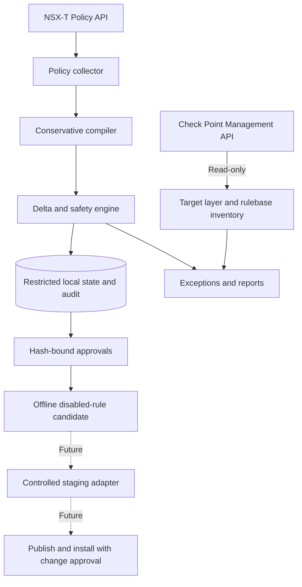

# NXTCheckpoint — NSX-T to Check Point Policy Assessment

> **Experimental read-only MVP.** Collects NSX-T Distributed Firewall policies, normalizes a conservative subset, detects changes and generates **offline disabled-rule candidates** for traditional Check Point Security Gateways. It **does not** create, update, publish or install Check Point rules.

## Project goals and boundaries

NXTCheckpoint is a generic, environment-independent toolkit for organizations planning coexistence or migration from VMware NSX-T Distributed Firewall (DFW) to centrally managed Check Point Security Gateways. It aims to make configuration assessment traceable, repeatable and safe.

**Important security distinction:** NSX DFW enforces rules near workloads. A conventional Security Gateway only enforces rules on traffic traversing it. Copying rules does not guarantee enforcement equivalence, particularly for East-West flows in the same subnet, VXLAN or distributed network. Routing, NAT, packet paths, shadow rules and implicit rules must be assessed separately.

The intended lifecycle is **observe → compare → review → stage → enforce**. The current release supports only **observe, compare, review and offline candidate generation**.

## Capability and maturity

| Capability | Status | Behaviour |
|---|---|---|
| NSX Policy API collection | Implemented | Policies, rules, groups and services in configured domains; cursor pagination |
| Conservative policy normalization | Implemented | Explicit IPv4 groups and L4 TCP/UDP services; unsupported constructs reported |
| Rule change detection | Implemented | Added, modified, removed and unchanged, using stable source IDs and hashes |
| Safety checks | Implemented | Rejects empty collections and excessive deltas |
| Check Point Management API | Read-only | Login, access layer/rulebase inventory, logout |
| Offline candidate export | Implemented | Rule-level hash approval and topology evidence; rules disabled |
| Periodic scheduling | Implemented | systemd service/timer, initially every 5 minutes |
| Check Point object/rule writes | Not implemented | No live staging |
| Publish and install policy | Not implemented | No automatic enforcement |
| Managed rollback / HA / drift remediation | Not implemented | Future work |

## Architecture



No component currently changes the Check Point configuration. The scope is **NSX DFW assessment**, not migration of virtual networking, NAT, Gateway Firewall or topology.

## Requirements

- Linux with Python 3.10+, `venv`, and optionally systemd.
- HTTPS reachability to NSX Manager and Check Point Management Server.
- NSX Policy API dedicated read-only credentials for configured domains.
- Check Point Management API key permitted to read the existing access layer and rulebase.
- Trusted CA certificate bundles for both endpoints; TLS verification must stay enabled.
- Restricted filesystem permissions for credentials, inventory and reports.
- Packet-path and topology evidence before approving candidates.

**Compatibility:** versions of NSX and Check Point APIs differ. No formal compatibility matrix has yet been certified. Test with the exact versions in your environment.

## Project structure

```text
nxtcheckpoint/
├── README.md
├── requirements.txt
├── pyproject.toml
├── config.example.yaml
├── sync_engine/
│   ├── cli.py
│   ├── nsx.py
│   ├── checkpoint.py
│   ├── http.py
│   ├── model.py
│   └── candidate.py
├── deploy/
│   ├── nsxcp.service
│   └── nsxcp.timer
├── docs/
│   ├── ARQUITECTURA.md
│   ├── MATRIZ_CONVERSAO.csv
│   └── GO_NO_GO.md
├── examples/approvals.example.json
└── tests/test_model.py
```

## Quick start

```bash
git clone https://github.com/emanique/nxtcheckpoint.git
cd nxtcheckpoint
python3 -m venv .venv
source .venv/bin/activate
pip install -r requirements.txt
pytest -q
cp config.example.yaml config.local.yaml
```

Update the local configuration with the source NSX endpoint, Check Point management endpoint, domain(s), trusted CA paths, existing Check Point layer and restricted state directory. Never commit local configuration with sensitive values, credentials or topology data.

```bash
export NSX_USER='readonly-account'
export NSX_PASSWORD='your-secret'
# Only needed with --check-checkpoint
export CP_API_KEY='management-api-key'
python -m sync_engine.cli --config ./config.local.yaml
python -m sync_engine.cli --config ./config.local.yaml --check-checkpoint
```

The second command queries Check Point **read-only**. Avoid storing secrets in interactive shell history on shared systems; use a secret manager or secured service environment file.

### Example configuration

```yaml
nsx:
  url: https://nsx-manager.example.internal
  username_env: NSX_USER
  password_env: NSX_PASSWORD
  ca_bundle: /etc/nsxcp/ca-nsx.pem
  domains: [default]
checkpoint:
  url: https://checkpoint-management.example.internal
  api_key_env: CP_API_KEY
  ca_bundle: /etc/nsxcp/ca-checkpoint.pem
  layer: NSX_MIGRATED_STAGING
  management_domain: null
sync:
  interval_seconds: 300
  state_dir: /var/lib/nsxcp
  max_rules: 5000
  max_change_percent: 15
  allow_ips: []
  approved_rule_prefix: NSXMIG_
  approvals_file: /etc/nsxcp/approvals.json
```

`interval_seconds` controls CLI `--loop`, while the systemd timer has an independent five-minute setting. `allow_ips` and `approved_rule_prefix` are configuration/reserved fields in this MVP; they do not activate network filtering or policy writes.

## Linux systemd deployment

```bash
sudo mkdir -p /opt/nsx-checkpoint-sync /etc/nsxcp /var/lib/nsxcp
sudo cp -a . /opt/nsx-checkpoint-sync/
cd /opt/nsx-checkpoint-sync
sudo python3 -m venv .venv
sudo .venv/bin/pip install -r requirements.txt
sudo cp config.example.yaml /etc/nsxcp/config.yaml
id nsxcp >/dev/null 2>&1 || sudo useradd --system --home /var/lib/nsxcp --shell /usr/sbin/nologin nsxcp
sudo chown nsxcp:nsxcp /var/lib/nsxcp
sudo install -o root -g nsxcp -m 0640 /dev/null /etc/nsxcp/credentials.env
sudo cp deploy/nsxcp.service deploy/nsxcp.timer /etc/systemd/system/
```

Configure `/etc/nsxcp/config.yaml`, trusted CA bundles and the root-protected `/etc/nsxcp/credentials.env` file in systemd `KEY=value` format (without `export`):

```ini
NSX_USER=readonly-account
NSX_PASSWORD=replace-me
CP_API_KEY=replace-me
```

The shipped service uses `--check-checkpoint`: supply a valid Management API key and target layer, or remove that flag if only collecting NSX. Ensure the service account can read CA/config files and write to `/var/lib/nsxcp`.

```bash
sudo systemctl daemon-reload
sudo systemctl enable --now nsxcp.timer
sudo systemctl start nsxcp.service
systemctl list-timers nsxcp.timer
journalctl -u nsxcp.service -n 100 --no-pager
```

Use **either** the systemd timer **or** `--loop`, not both; the MVP does not have cross-process locking or distributed leader election.

## State files and confidentiality

| File | Contents |
|---|---|
| `latest_snapshot.json` | Raw NSX inventory, including potentially sensitive IPs and policies |
| `latest_plan.json` | Compiled rules, hashes and conversion exceptions |
| `latest_report.json` | Cycle UTC timestamp, deltas and validation results |
| `last_good.json` | Last successfully accepted assessment baseline |
| `history/*.json` | Historical run summaries |
| `latest_candidate.json` | Optional offline candidate with disabled rules |

**Note:** `last_good.json` is not a record of policies actually installed on Check Point. Keep the state directory outside Git, protected and subject to operational retention/backup controls.

## Delta and fail-closed processing

The collector computes SHA-256 fingerprints over canonical rule representations, compares source IDs with the previous accepted assessment, and classifies changes as added, removed, modified or unchanged. The process blocks empty inventories and excessive changed-rule percentages according to `max_change_percent`.

A successful assessment only confirms local collection/compilation conditions. It does **not** demonstrate a complete NSX configuration inventory, live rule equivalence or production readiness.

## Candidate generation

Review `latest_plan.json` and the exceptions, then provide a JSON approval map keyed by `source_id`, with the matching `hash`, `topology_evidence` and `approver`. See `examples/approvals.example.json`.

```bash
python -m sync_engine.candidate \
  --state-dir /var/lib/nsxcp \
  --approvals /etc/nsxcp/approvals.json
```

The exporter rejects unsupported/changed/unapproved rules. Every accepted rule is output with `enabled: false`; **there is no Check Point API write**. Approval fields are checked for presence and hash equality, not cryptographic identity or evidence authenticity. An external change-management process must govern real approvals.

## Rule conversion matrix

| NSX element | Check Point representation | MVP |
|---|---|---|
| Simple static IPv4 address group | Host, network, group | Offline candidate |
| TCP/UDP destination port | TCP/UDP service | Offline candidate |
| ALLOW / DROP / REJECT | Accept / Drop / Reject | Mapped; traffic effect unverified |
| Tags, dynamic or nested groups | Governed dynamic objects | Rejected |
| Applied-To and scoped DFW | Gateway-specific policy scope | Rejected |
| ANY scoped semantics | Requires topology review | Rejected |
| Ethernet/L2 and stateless rules | No direct equivalence | Rejected |
| Source-port constraints, security profiles | Extra semantics | Rejected |
| NSX NAT / Gateway Firewall | NAT / policy rules | Out of scope |
| Policy precedence and rule ordering | Check Point ordered rulebase | Recorded, not enforcement-validated |

Generated candidate objects are **not** guaranteed to be ready-to-submit `add-access-rule` payloads. A future adapter must handle actual target objects, metadata, ownership, duplicates, collisions, rule positions and session transactions.

## Validation and Go/No-Go

```bash
pytest -q
python -m compileall -q sync_engine
```

Bundled tests are local unit tests, not integration tests against real appliances. Perform integration and negative testing: API authentication/authorization failures, TLS mismatches, pagination loops, deleted/missing rules, dynamic expressions, topology bypass, unexpected deltas, concurrent edits, rulebase shadowing, HA behaviour and rollback.

Before any future enforcement release, require: verified source inventory, route/packet-path equivalence, supported rule mapping, owner sign-off, rulebase ordering proof, allowed-and-denied traffic tests, target backup, approved change window and tested rollback.

## Security recommendations

Use least-privilege identities, trusted CAs, external secret management, audited credential rotation and restricted report storage. Do not disable TLS checks or place inventories and policies in public issues or logs. **Automatic deletion, publish or install based solely on source changes must never be enabled without additional controls.**

## Troubleshooting

| Problem | Recommended check |
|---|---|
| `FAIL-CLOSED` | CLI stderr and `journalctl -u nsxcp.service` |
| TLS/certificate failure | DNS, SAN, chain and configured CA |
| Empty NSX inventory | Domain, API permissions, endpoint, pagination |
| Excessive delta | Investigate configuration changes and collection completeness |
| Missing Check Point layer | Layer name, management domain and API permissions |
| Zero approved candidates | Exceptions, matching hashes and required evidence |
| Inactive scheduler | `systemctl list-timers`, service credentials and filesystem permissions |

## Planned roadmap — NOT implemented

1. Stronger NSX inventory completeness and advanced group semantics.
2. Explicit traffic-path and effective policy equivalence analyzer.
3. Idempotent Check Point management staging writer and ownership model.
4. Authenticated approval workflow, audit and drift detection.
5. Controlled publish/install, verification, HA-aware rollback.
6. Versioned integration tests, supported compatibility matrix, dashboards and packages.

## Contribution guidance

Use feature branches/PRs, synthetic test fixtures and tests for negative/unsupported cases. Never submit customer policies, production IP ranges or credentials. This independent toolkit is not affiliated with or endorsed by either platform vendor.

## References

- [NSX-T REST API](https://developer.broadcom.com/xapis/nsx-t-data-center-rest-api/latest/)
- [Check Point Management API](https://sc1.checkpoint.com/documents/latest/APIs/)
- [Detailed architecture](docs/ARQUITECTURA.md)
- [Conversion matrix](docs/MATRIZ_CONVERSAO.csv)
- [Semantic conversion and automation design](docs/AUTOMATIZACAO_CONVERSAO.md)
- [Go/No-Go checklist](docs/GO_NO_GO.md)

## License

This project is distributed under the **MIT License**. See the [LICENSE](LICENSE) file for the full license terms. Copyright (c) 2026 emanique.
