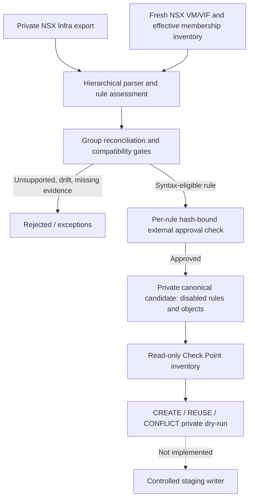

# Canonical bridge: hierarchical NSX export → guarded Check Point dry-run

This experimental feature connects the **private hierarchical NSX Infra exporter** with the existing **Check Point object dry-run**. It contains no target mutation methods and does not publish or install firewall policies.

## Architecture



## What is integrated

The bridge uses `sync_engine.offline.assess` for rule compatibility and `sync_engine.reconcile` for IPv4 effective group membership checks. Supported IPv4 groups and TCP/UDP services are normalized into objects with deterministic `NSXMIG_` names. Candidate rules retain action, log status, a source-derived content hash and `enabled=false`. The existing `sync_engine.object_plan.build_plan` accepts the resulting candidate and compares it to a complete target snapshot or live **read-only** inventory.

**Classification B is not approval.** Only a rule with no current blocker AND a matching full rule hash, named approver, topology evidence and precedence evidence is converted. The approval file is treated as an external assertion: no cryptographic verification of identity/evidence is implemented. The rule always remains **disabled**.

### Step 1: private NSX inventory

```bash
python -m sync_engine.inventory \
  --config /etc/nsxcp/config.yaml \
  --output /secure/private/inventory-run-001
```

### Step 2: generate a private, unapproved review worksheet

```bash
python -m sync_engine.approval_template \
  --input /secure/private/nsx-export.json \
  --inventory-file /secure/private/inventory-run-001/inventory.private.json \
  --output /secure/private/approvals.json
```

The generated JSON is keyed by pseudonymous rule ID and contains the effective dependency hash (source rule, referenced group definitions, resolved members and services). **All approval and evidence fields are blank**. Generating this file grants no authorization. Only authorized change personnel should populate the fields after actual routing and precedence checks.

```json
{
  "example-rule-id": {
    "rule_hash": "sha256-of-rule-and-effective-dependencies",
    "approver": "",
    "topology_evidence": "",
    "precedence_evidence": ""
  }
}
```

These fields are **unverified textual assertions**, not digital signatures. A later release must connect them to a governed approval service.

### Step 3: canonical candidate from NSX Infra export

```bash
python -m sync_engine.canonical_bridge \
  --input /secure/private/nsx-export.json \
  --inventory-file /secure/private/inventory-run-001/inventory.private.json \
  --max-inventory-age-seconds 600 \
  --approvals /secure/private/approvals.json \
  --output /secure/private/canonical-001
```

Output: `canonical_candidate.private.json` (file permission 0600).

With no approvals, the bridge produces zero eligible rules, with explicit reasons for rejection. No source permissions are widened.

### Step 4: Check Point object dry-run

```bash
python -m sync_engine.object_plan \
  --candidate /secure/private/canonical-001/canonical_candidate.private.json \
  --config /etc/nsxcp/config.yaml \
  --output /secure/private/object-plan-001
```

**Fail-closed:** the current object planner rejects candidates with any rejected rules. A partially eligible export therefore requires a deliberately scoped, separately approved migration cohort; it is not automatically filtered or forcibly imported. To assess conflict-free objects only, isolate the intended candidate cohort under change governance. Do not edit or falsify approval fields to bypass gates.

## Limitations (critical)

- **No effective DFW order synthesis.** Rules are sorted deterministically for diagnostics, not in validated NSX processing order. No gateway rule insertion position is produced.
- **No path enforcement proof.** Text fields for topology and precedence evidence are assertions, not verified technical results.
- **No coherent atomic source snapshot proof.** The export and live inventory can represent different points in time.
- **No direct Check Point policy write.** No `add-*`, `set-*`, `publish`, `install-policy` or rollback operations.
- **No comprehensive supported NSX expression handling.** Tags, unsupported protocols, identity conditions, advanced rules and scoped DFW may be rejected.
- **Target object snapshot freshness and completeness** must be established outside the tool. A successful object dry-run does not mean the policy can be enforced safely.
- **Private output contains addresses and policy structure** and is not suitable for public distribution.

## Test coverage

```bash
pytest -q tests/test_canonical_bridge.py tests/test_object_plan.py
pytest -q
```

Synthetic fixtures verify approval omission, rule-hash changes, membership drift, unsupported scope, disabled candidates and a fully private NSX-to-dry-run flow. The original input export is never included in the repository or GitHub CI.

## Production Go/No-Go

**NO-GO for automatic production rule enablement** until topology, L2/L3 traffic paths, effective rule precedence, target policy isolation, signed change control, concurrent edit protections, HA, installation health, regression tests and rollback are implemented and validated against supported platform releases.

## Dependency-bound approvals

The `rule_hash` field is now generated by `sync_engine.dependency_hash.semantic_rule_hash` over the source rule **and** referenced group definitions, resolved IPv4 membership, identity dependencies and referenced service definitions. Any change to these inputs invalidates an existing approval even when the rule itself has not changed. The hash is not an authorization signature: reviewer identity and evidence remain external, unverified assertions.

Never treat an updated private approval worksheet as evidence that the route or Check Point rulebase is secure. After any dependency change, obtain a fresh technical review and change approval.
